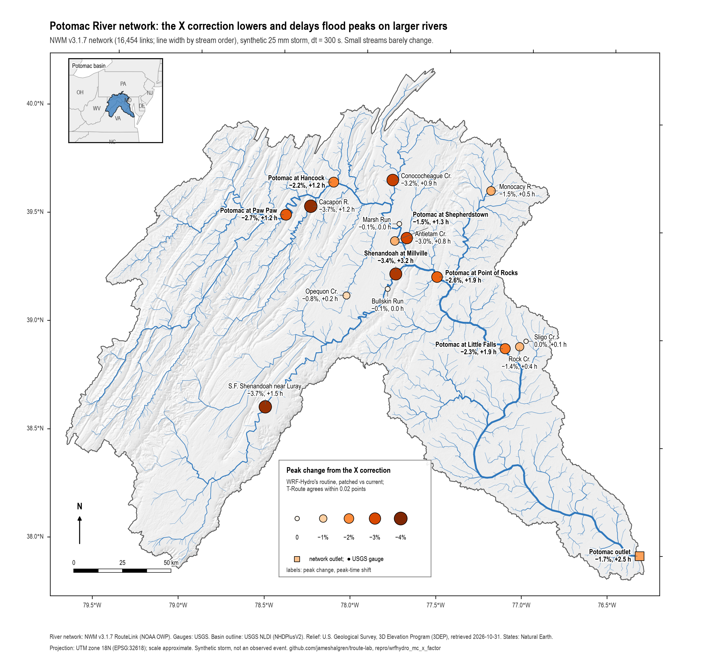
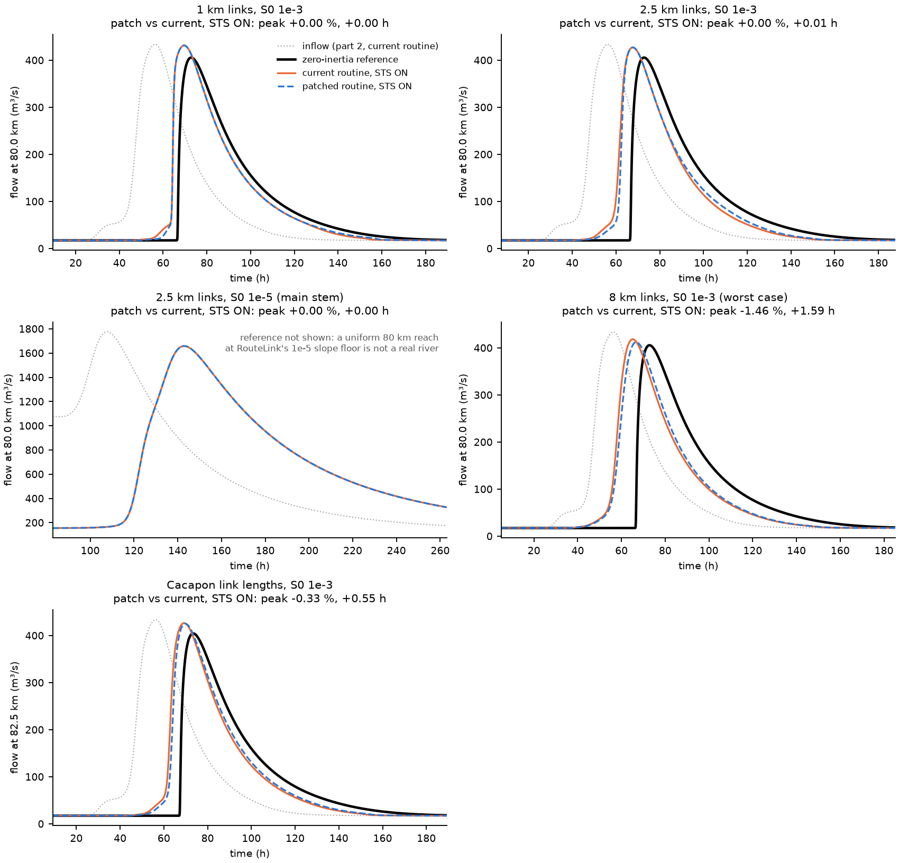
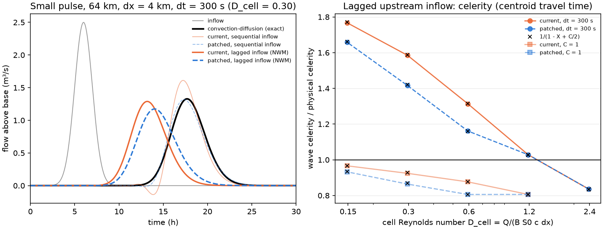

# WRF-Hydro Muskingum-Cunge X extra factor of 2
Evidence for [NCAR/wrf_hydro_nwm_public#921](https://github.com/NCAR/wrf_hydro_nwm_public/issues/921)
and the PR that fixes it, [#923](https://github.com/NCAR/wrf_hydro_nwm_public/pull/923).

**TL;DR**
> On the NWM v3.1.7 Potomac network, the correction to the X factor *lowers and delays flood peaks on larger rivers by a few percent* (i.e., the peaks were too high and too early)
(lowers by 1.5–3.7% for reaches with catchment area above 
  about 650 km²; delays are between 1–3 hours). 

Small streams barely change, and the water volume is unchanged. So the impact on the operational NWM is probably small. This is for
a synthetic test with 25mm runoff, no reservoirs nor data assimilation. 

I will post the test link under https://jameshalgren.github.io/troute-lab later this week.
>
> — James Halgren, comment on [#923](https://github.com/NCAR/wrf_hydro_nwm_public/pull/923), 2026-11-02


*The following text is heavily AI-assisted for development and writing (Claude) reviewed by James H. on 2026-11-02;
Developed and tested on macOS arm64, gfortran (GNU Fortran 16.2.0, Homebrew) only.*


*Detail:*
- The correction to the X factor in the PR *lowers and delays flood peaks on larger rivers*.
- For a synthetic storm (25mm precip) over the NWM v3.1.7 Potomac network, with default NWM
  WRF-Hydro routing settings, the following results are observed on the channel network:
  - Mid-size rivers and the main stem (650–28,000 km²): peaks drop 1.5–3.7% and arrive
    0.8–3.2 h later.
  - The outlet: −1.70%, +2.5 h.
  - Small streams (< 100 km²) barely change, by at most 0.13%.
- T-Route reproduces these changes to within 0.02 percentage points and 0.06 h.
- The patch does not change the network's water volume.
- On a single river reach that carries an already-formed flood, the change is small:
  - 0.00% for 1 km and 2.5 km links. X sits on its 0.25 floor in both versions at storm
    flows.
  - −0.33% (+0.55 h) along the real link lengths of the lower Cacapon.
  - −1.46% (+1.59 h) for 8 km links, the worst case.
- So the network-wide change builds up upstream, while the flood is forming in the
  tributaries, rather than on any one reach.

*Note:*
This test is no longer needed, as the PR is on track to be merged, but could be a useful
instrument if other similar kernel issues are discovered.

**Questions.** Does `SUBMUSKINGCUNGE` deliver the expected physical diffusion? To what
extent does the patch [`wrf_hydro_mc_x_cunge.patch`](wrf_hydro_mc_x_cunge.patch) fix the
discrepancy? And, specifically, what does the fix change in the operational NWM setting?

## The NWM condition

Every headline result in this README uses the NWM's operational channel setting, with alternative settings reported in the appendix:
- **STS ON**, the short-time-step assumption. Each link's upstream inflow is the upstream
  link's outflow from the *previous* time step (`qup = quc`). This is what WRF-Hydro's
  channel driver (`DRIVE_CHANNEL`) does and what the operational NWM uses. In T-Route it is
  `assume_short_ts: True`.
- **dt = 300 s**, the NWM channel time step (`DTRT_CH = 300`).
- **NWM v3.1.7 links**: their lengths, slopes and channel geometry, including the compound
  (overbank) channel.
- **A storm hydrograph**, not a sharp pulse.

The alternative setting is **STS OFF (real qdc)**: the current-step upstream outflow (qdc),
which is T-Route's `assume_short_ts: False`. It appears here only as context, after the
NWM result, and in Appendix B. Switching the short-time-step to OFF changes results 10–20× more than the patch to the X parameter does.

## How to run

```bash
repro/wrfhydro_mc_x_factor/run.sh   # ~2.5 min after initial build; exit 0 = reproduced (462 checks)
```

- Needs `uv`, `gfortran` and `patch`. Python dependencies are pinned in `pyproject.toml`
  and `uv.lock`.
- Part 3 (T-Route) also needs `../short_ts_switch/run.sh` to have been run once, because it
  reuses that harness's T-Route inputs. Otherwise it is skipped.
- `QUICK=1` runs only the prismatic theory tests (Appendix A, about a minute).
  `SKIP_TROUTE=1` skips part 3.
- Run times on an Apple M4 Max, 2026-11-02:
  - Whole `run.sh`: 2 min 18 s.
  - Part 2: four WRF-Hydro runs in parallel, 40 s each.
  - Part 3: four T-Route runs in parallel, 68 s each.
  - Part 1 under NWM conditions: about 15 s.

| Step | Script | What it does |
|---|---|---|
| build | `build_harness.py` | Downloads `src/Routing/module_channel_routing.F90` from NCAR/wrf_hydro_nwm_public at `55ed71c8` (main, 2026-10-09), applies the patch, extracts `SUBMUSKINGCUNGE` verbatim from both files, and compiles both with WRF-Hydro's own gfortran flags into two drivers: `fortran/driver.F90` (one reach) and `fortran/network_driver.F90` (a network, driven like `DRIVE_CHANNEL`). Stubs (`fortran/stubs.F90`) stand in for `hydro_stop`, `linkls_s` and `my_id`. The whole WRF-Hydro model was **not** built. (We didn't have MPI locally.) |
| part 2 | `fetch_data.py`, `potomac_inputs.py`, `network_driver` | WRF-Hydro's routine on the Potomac network (below) |
| part 1, NWM | `reaches.py` | Single reaches built from NWM links (below); needs part 2's outputs |
| part 3 | `troute_part3.sh` | T-Route on the same storm |
| analysis | `potomac_analyze.py`, `potomac_map.py` | tables, map |
| theory | `derive_modified_equation.py`, `analyze.py` | the prismatic-channel tests (Appendix A) |
| checks | `check.py` | 462 checks against `expected/expected.json` |

`run.sh` writes everything to `results/` (not committed). The figures shown here are
copies in `figures/`, so they show on GitHub.

## 1. The Potomac network (parts 2 and 3), NWM conditions

**Setup.**
- **Network.** All 16,454 NWM v3.1.7 RouteLink links upstream of feature 4539621 (the
  Potomac outlet). `RouteLink_CONUS.nc` comes from NCEP and is SHA-256-checked by
  `fetch_data.py`.
- **Storm.** 25 mm of runoff over every link, in proportion to its length, with a gamma
  time distribution (k = 3, θ = 4 h) starting at 24 h. Base flow is 0.01 m³/s/km². The run
  is 40 days long.
- **Routine.** WRF-Hydro's verbatim routine, current and patched, driven like
  `DRIVE_CHANNEL`: STS ON, dt = 300 s, 12 steps per hour, lateral inflow held for the hour,
  no channel loss.
- **Compound channel.** It is used: 16% of segment-steps are overbank.
- **T-Route (part 3).** The same storm through T-Route (CIROH-UA `d29f663` with
  `../kernel_fixes` patches), current and patched kernel, `assume_short_ts: True`.



**Peak change from the patch (STS ON, dt = 300 s)**

| Record point | Model area (km²) | WRF-Hydro | T-Route |
|---|---|---|---|
| Sligo Creek near Takoma Park | 12 | −0.01%, +0.08 h | −0.01%, +0.05 h |
| Marsh Run at Grimes | 31 | −0.07%, 0.00 h | −0.07%, +0.01 h |
| Bullskin Run below Kabletown | 36 | −0.13%, 0.00 h | −0.12%, +0.01 h |
| Rock Creek at Joyce Rd | 129 | −1.37%, +0.42 h | −1.36%, +0.43 h |
| Opequon Creek near Berryville | 134 | −0.82%, +0.17 h | −0.80%, +0.15 h |
| Monocacy River at Bridgeport | 498 | −1.50%, +0.50 h | −1.50%, +0.49 h |
| Antietam Creek near Sharpsburg † | 656 | −3.03%, +0.83 h | −3.01%, +0.82 h |
| Conococheague Creek at Fairview | 1,212 | −3.17%, +0.92 h | −3.15%, +0.89 h |
| Cacapon River near Great Cacapon | 1,734 | −3.74%, +1.25 h | −3.73%, +1.27 h |
| S F Shenandoah River near Luray | 2,371 | −3.69%, +1.50 h | −3.69%, +1.52 h |
| Shenandoah River at Millville | 5,079 | −3.42%, +3.17 h | −3.42%, +3.16 h |
| Potomac River at Paw Paw | 8,280 | −2.72%, +1.17 h | −2.73%, +1.12 h |
| Potomac River at Hancock | 10,829 | −2.16%, +1.25 h | −2.17%, +1.19 h |
| Potomac River at Shepherdstown | 15,564 | −1.46%, +1.33 h | −1.46%, +1.31 h |
| Potomac River at Point of Rocks | 22,255 | −2.62%, +1.92 h | −2.62%, +1.89 h |
| Potomac River at Little Falls | 27,643 | −2.30%, +1.92 h | −2.30%, +1.95 h |
| Outlet (feature 4539621) | 35,249 | −1.70%, +2.50 h | −1.70%, +2.47 h |

† The NWM routes 656 km² to the Antietam gauge's link (USGS: 728 km²). For the same
COMID, NHDPlusV2's TotDASqKM is 16,124 km², because it counts flow through a minor
divergence; its DivDASqKM is 730 km². See `AREA_NOTES` in `potomac_inputs.py`.

- **The whole network (median change in peak above base flow, by model drainage area):**

  | Drainage area (km²) | Median change |
  |---|---|
  | < 25 | 0.00% |
  | 25–100 | −0.06% |
  | 100–300 | −0.39% |
  | 300–1,000 | −1.36% |
  | 1,000–3,000 | −2.81% |
  | 3,000–10,000 | −2.87% |
  | > 10,000 | −2.29% |

  82% of all links get a lower peak. The rest are unchanged, or at most 0.035% higher.
- **X on its 0.25 floor:**
  - 18.4% of segment-steps with the current routine, 20.0% patched.
  - Weighted by flow: 86% current, 91% patched. Most of the water moves while X sits on
    the floor in both versions, and there the patch changes nothing.
- **Volume and solver.** The patched outlet volume is 0.99992 of the current one. The
  outlet volume is 1.002 of the lateral inflow. Neither run printed a convergence warning.
- **T-Route against WRF-Hydro** (STS ON): peak changes agree within 0.02 percentage points
  and timing shifts within 0.063 h. The current-kernel peaks agree within 0.084%. So the
  fix behaves the same in both codes, which is what makes T-Route useful for testing kernel
  changes like this one.
- **For context, STS OFF (real qdc)** (details in Appendix B):
  - The patch's effect is smaller and goes either way: outlet +1.08%, −0.42 h; Millville
    +4.38%, −2.75 h; Antietam −4.51%, +0.92 h.
  - Switching STS itself moves the outlet peak by +38% and 77.5 h, against the patch's
    1.7% and 2.5 h.

## 2. Single reaches built from NWM links (part 1, NWM conditions)

**Why.** The theory tests in Appendix A use one prismatic channel (S0 = 10⁻³) with links of
0.5–8 km and a sharp 1-hour pulse. That isolates the X question, but it doesn't look like
an NWM river. So `reaches.py` builds single reaches from NWM v3.1.7 links, and drives them
with a storm hydrograph from part 2.

**Setup** (`reaches.py`):
- **Reach.** A uniform 80 km reach, cut into links of one length, routed with the verbatim
  routine, current and patched, at STS ON and dt = 300 s.
- **Channel.** Every channel parameter is a median over the RouteLink links of one group.
  None is chosen by hand.
  - **Mid-size rivers** (259 links): BtmWdth 12–30 m and So 5×10⁻⁴ to 2×10⁻³. Medians:
    n = 0.05, ChSlp = 0.28, BtmWdth = 15.4 m, TopWdth = 25.6 m, TopWdthCC = 76.9 m,
    nCC = 0.1. That gives a bankfull depth of 1.43 m, so even base flow is overbank.
  - **Main stems** (377 links): stream order ≥ 6, at the So floor (≤ 1.5×10⁻⁵).
    BtmWdth = 38.8 m, TopWdth = 64.6 m, TopWdthCC = 193.9 m, ChSlp = 0.19.
- **Inflow.** Part 2's simulated hydrograph at a gauge whose flows fit the group:
  - Cacapon River near Great Cacapon for the mid-size cases, 17 → 434 m³/s.
  - Potomac River at Shepherdstown for the main stem, 156 → 1,775 m³/s.
- **Reference.** A fine-grid (100 m) zero-inertia (diffusive-wave) solution on the same
  compound channel, built on the routine's own stage–discharge relation (composite Manning
  n) and storage widths.
- **"Stands for".** For each case, the links in the network that match it: length within
  20%, plus the group's slope and width. For those links, it also reports what they did in
  part 2. River names are GNIS names of the NHDPlusV2.1 flowlines (Esri Living Atlas copy,
  looked up 2026-11-02, cached in `data/nhdplus_names.json`). They are labels only.

**Network link lengths, for scale.**
- By count: median 1.44 km, 75th percentile 2.35 km, 90th 3.53 km, 99th 7.6 km.
- Weighted by length: median 2.54 km.



**Results, STS ON (dt = 300 s), patched against current**

| Case | What it stands for | X, current / patched: base flow → peak | Peak change, shift |
|---|---|---|---|
| **1 km links, S0 10⁻³** | 38 links (0.23% of the network): South Branch Potomac 8, Back Creek 7, Cacapon 5, S F Shenandoah 5, North Branch Potomac 3 | 0.387 / 0.273 → floor / floor | 0.00%, 0.00 h |
| **2.5 km links, S0 10⁻³** | 32 links: South Branch Potomac 5, Cacapon 4, Monocacy 3, S F Shenandoah 3, North Branch Potomac 3 | 0.455 / 0.409 → floor / floor | 0.00%, +0.01 h |
| **2.5 km links, S0 10⁻⁵ (main stem)** | 30 links: Potomac 16, Monocacy 5, Shenandoah 5, Occoquan 3 | floor / floor always | 0.00%, 0.00 h |
| **8 km links, S0 10⁻³ (worst case)** | 15 links (0.09%): North Fork Shenandoah 3, South Branch Potomac 3, Middle River 2, Conococheague 2 | 0.486 / 0.472 → 0.395 / 0.290 | −1.46%, +1.59 h |
| **The Cacapon's own link lengths, S0 10⁻³** | the 56 links (0.02–5.8 km) of the lower 82.5 km of the Cacapon above gauge 01611500 | (varies by link) | −0.33%, +0.55 h |

**What each case means.**
- **1 km: a typical link, by count.**
  - Matching links lie on the South Branch Potomac, Back Creek, the Cacapon and the South
    Fork Shenandoah. For comparison, the lower Monocacy (Bridgeport to the mouth) also has
    a median link of 0.99 km, but at least half its links sit at the 10⁻⁵ slope floor.
  - At base flow the patch lowers X (0.387 → 0.273). At storm flow, X is on the 0.25 floor
    in both versions, so the peak doesn't change.
  - In part 2, the same links still see their peaks drop by a median of 2.1%. That change
    arrives from upstream.
- **2.5 km: the length-weighted median.** Half the network's channel length is in links
  shorter than 2.54 km. The result is the same as for 1 km: X is on the floor at the peak in
  both versions, and the peak doesn't change.
- **Main stem: X is always on the floor.**
  - 62% of the length of stream-order ≥ 6 links sits at RouteLink's 10⁻⁵ slope floor.
  - Those links had X on the floor in 100% of part 2's steps, current and patched. The
    patch cannot change them.
  - Their −2.2% median peak change in part 2 is carried down from the tributaries.
- **8 km: about the network's 99th percentile of link length (7.6 km), and the worst case
  for this channel.**
  - In the NWM, most links that long are steep first-order headwaters: 140 of the 218
    links over 7 km, with a median peak of 6.5 m³/s. There X barely changes. The median
    peak change on those links is −0.01%, and the 10th percentile is −1.5%.
  - Only 15 mid-size-river links are like this case.
- **The Cacapon's real mix of short and long links: −0.33%, +0.55 h over 82.5 km.** At the
  Cacapon gauge, part 2 shows −3.74%. So most of the network's change is not made on the
  river reach that carries the flood peak.

**Where the network change comes from** *(interpretation; not tested separately)*.
- X sits on its floor in both versions whenever the flow is large relative to the link's
  channel (Q/(B·S0·c·Δx) ≥ 1). A formed flood on a mid-size river is in that range.
- The patch acts where flows are smaller relative to the channel: in the tributaries and
  links of 100–3,000 km² while the flood is forming, and on the rising and falling limbs.
  The lower, later peak is then carried down the network.
- This fits two results:
  - Part 2's change grows with drainage area from 100 km² upward.
  - A single reach carrying a formed flood changes little.

**Against the zero-inertia reference** (mid-size cases, STS ON):
- Both versions run 3–8 h early and 3–6% high over 80 km:
  - 1 km: +6.4%, −3.2 h, both versions.
  - 2.5 km: +5.3%, −5.1 h, both versions.
  - 8 km: current +3.1%, −7.7 h; patched +1.6%, −6.1 h.
  - Cacapon lengths: current +5.4%, −4.2 h; patched +5.1%, −3.6 h.
- The early arrival is STS ON's too-fast waves (Appendix A.4). Where the patch acts, it
  moves both the peak and its timing toward the reference.
- The main-stem case has no meaningful reference. RouteLink's main stem alternates links at
  the 10⁻⁵ floor with steeper ones: from Hancock to Little Falls the length-weighted mean
  slope is 5.8×10⁻⁴, and half the length sits at the floor. A uniform 80 km at 10⁻⁵ is not
  a real river.
- With STS ON, volume closes within 0.4% in every case, there is no leading-edge dip, and
  there are no convergence warnings.

**For context, STS OFF (real qdc)** (details in Appendix B):
- 1 km: 0.00%. 2.5 km: +0.17%, −0.21 h. 8 km: −3.99%, +1.17 h. Cacapon: −0.46%,
  +0.11 h. Main stem: 0.00%.
- With STS OFF, the mid-size cases lose 1–6% of the storm volume.
- Their outflow dips ahead of the wave, from a base of 17 m³/s to as low as 1–7 m³/s.
- The 2.5 km current run printed one convergence warning (the solver problem in
  Appendix C).

## Caveats (for the NWM reading)

- **Synthetic storm.** A uniform, length-weighted storm on one network. Real storms are
  patchy, and gauge-by-gauge changes would differ. Part 2 is not a forecast.
- **Uniform reaches in part 1.** The NWM-condition cases use one median channel per group.
  The Cacapon case uses its real link lengths but a uniform slope and geometry.
- **Overbank is exercised.** In part 2, 16% of segment-steps are overbank, and every
  part-1 NWM case is overbank at the peak. The patch changes the overbank (`TwCC`) branch
  in the same way as the in-bank one.
- **Only the subroutine was built.** The patched file was compiled only as the extracted
  subroutine. The full model was not built.
- **STS OFF is context only.** The harness runs both settings, but only STS ON is the
  NWM's. Under STS OFF, T-Route and WRF-Hydro differ by up to 2.7 percentage points (at
  Luray and Antietam). The cause is WRF-Hydro's depth solver on a few near-dry links that
  only STS OFF produces, and there the STS OFF results also shift with compiler rounding
  (Appendix C). The STS ON results are not affected.

---

## Appendix A. The X factor in theory: prismatic-channel tests

*These are the original tests of this harness, run on one prismatic channel at a range of
segment lengths and time steps. They show the theory behind the fix. Under NWM conditions
(above), most of the effects shown here are smaller or absent.*

### A.1 What it does

0. **The reference solution.** The "exact" solution is the analytical solution of the
   linearized convection–diffusion equation for an inflow at the upstream end of a
   semi-infinite channel: Hayami (1951), Eq. (40), p. 8,
   [hdl.handle.net/2433/123641](http://hdl.handle.net/2433/123641). We use it in the
   discharge form, with the discrete convolution, of Wang et al. (2014), *J. Hydrol.*
   509:282–294, Eqs. (2)–(3) and (5)–(6),
   [doi:10.1016/j.jhydrol.2013.11.046](https://doi.org/10.1016/j.jhydrol.2013.11.046). It is
   implemented in `analyze.py`, function `hayami()`: the inflow's excess over base flow is
   convolved with the kernel x/(2√(πDt³))·exp(−(x − ct)²/(4Dt)), where c is the kinematic
   celerity and D = Q/(2·B·S0). The formula was checked against both papers and verified
   symbolically on 2026-10-26. As an independent check, a fine-grid (100 m) zero-inertia
   solver agrees with it to 0.1% at the peak.
1. **`derive_modified_equation.py`** (sympy). It Taylor-expands the Muskingum box
   scheme, the scheme behind the kernel's C1–C3 with K = Δx/c. The scheme adds
   numerical diffusion ν = c·Δx·(½ − X) + c²·Δt·(θ − ½). Muskingum uses θ = ½, so
   ν = c·Δx·(½ − X). Setting ν equal to the physical diffusivity D = Q/(2·B·S0) gives
   X = ½(1 − Q/(B·S0·c·Δx)). The kernel's X gives ν = Q/(4·B·S0) = D/2.
2. **`build_harness.py`** (see "How to run"). The one-reach driver routes an inflow through
   N identical reaches, with no lateral inflow and no channel loss. A fifth argument
   selects the upstream inflow: `sequential` (STS OFF, real qdc; the default) or `lagged`
   (STS ON).
3. **`analyze.py`** runs the experiment on one prismatic trapezoidal channel:
   Q0 = 50 m³/s, Bw = 20 m, ChSlp = 0.5, n = 0.045, S0 = 10⁻³, routed 64 km, in-bank only.
   - The segment length Δx is 0.5–8 km, so the cell Reynolds number
     D_cell = Q/(B·S0·c·Δx) runs from 2.4 down to 0.15.
   - The time step is the NWM's 300 s and also the one that gives C = 1.
   - **Small pulse (5% of base flow, linear regime).** Compared against the exact
     convection–diffusion solution (Hayami kernel).
     - The headline metric is the effective diffusivity. It comes from the growth of
       the hydrograph's temporal variance: D_eff = Δσ²·c³/(2L).
     - The same linear test is also run with constant-parameter MC, which isolates the
       factor 2.
   - **Large pulse (50 → 200 m³/s, nonlinear).** Compared against the zero-inertia
     solver.
   - Every case runs with STS OFF (real qdc) and with STS ON.

### A.2 Results, STS OFF (real qdc): the diffusion the routine delivers

These results use STS OFF because, with it, the routine is still a Muskingum scheme and the
diffusion theory applies directly. Under STS ON it doesn't (A.4).


**Linear, constant-parameter MC.**
- With the kernel's X, D_eff/D = 0.500 in every case.
- With Cunge's X, D_eff/D = 1.000. Both hold to 3 decimals and at C = 0.06 to 1.

**The verbatim WRF-Hydro routine, small pulse.**

| D_cell | X on the 0.25 floor? | current kernel D_eff/D | patched D_eff/D | peak above base, current / patched (exact = 1) |
|---|---|---|---|---|
| 0.15 | neither | 0.51 | 1.01–1.02 | 1.10–1.34 / 0.96–1.06 |
| 0.30 | neither | 0.51–0.55 | 1.02–1.06 | 1.21–1.25 / 0.99 |
| 0.59 | patched only | 0.51–0.52 | 0.84 | 1.24 / 1.06 |
| 1.19, 2.37 | both | 0.21–0.43 | identical | 1.30–1.51 / identical |

So the current kernel delivers half the physical diffusion wherever its X is not on
the floor, and the patch restores it. Where both X are on the 0.25 floor
(D_cell > 1), the patch changes nothing. There, the floor under-diffuses by its own
amount, and peaks are 30–50% too high above base flow.

### A.3 Large pulse (nonlinear), against the zero-inertia reference


The large pulse (50 → 200 m³/s) has no analytical solution, so the reference is a fine-grid
(100 m) zero-inertia (diffusive-wave) solution of the same channel. The current and the
patched routine are both compared with it. In this nonlinear regime the routine's other
errors (below) compensate for one another, so the peak comparison is reported as context,
not as evidence for or against the fix.
- The patch lowers the hydrograph RMSE in all 9 cases (by 4% to 71%). It brings the
  volume closer to the inflow volume in 6 of 9 cases.
- It does **not** improve the peak. The absolute peak error gets worse in 7 of 9 cases
  and better in 2. At dx = 8 km, dt = 300 s, the current kernel's peak happens to match
  (error +0.000 of the reference's peak above base flow), against −0.196 patched.
- In this regime the routine's other errors are as large as the X effect or larger:
  - a dip ahead of the wave: with the current X, the outflow first falls below the 50 m³/s
    base flow, to as low as 8–27 m³/s (`min_flow` in `results/summary.json`), at dx = 4–8 km
    and small Courant numbers. The mechanism for this is that the Muskingum coefficient
    C2 = (dt/2 − K·X)/D is negative whenever the Courant number is below 2X. A sharply rising
    inflow then pulls the outflow down at first. The current X (what we're trying to fix) is
    too large and deepens the dip. (At C ≈ 1, and above, where K is clamped to dt, C2 is zero
    or positive, so there's no dip in either the current or the patched algorithm.) With the
    patched X the minimum stays at 45–50 m³/s in all but one case (29 m³/s at dx = 8 km,
    dt = 2700 s). The same mechanism on a real network is examined in `../short_ts_switch`
    ("Mechanism checks"). **With STS ON there is no dip** (minimum 50.0 m³/s in all 9 cases).
  - late peaks from the K clamp, by design of the test: in the three cases where dt was
    chosen so that C ≈ 1 at base flow, the higher celerity at the peak pushes the Courant
    number above 1. The routine then clamps the Muskingum K to dt (K = max(dt, Δx/c)), and
    the wave slows. Peaks arrive 2.4–2.6 h late with STS OFF (real qdc) and 2.8–5.3 h late
    with STS ON, in both the current and the patched routine. This K clamp is a different
    limit from the X ≥ 0.25 floor, and the patch does not remove it. 
  - early peaks at the NWM's dt = 300 s with STS ON: these grids are not clamped, but lagged
    inflow makes waves travel faster than physical (1/(1 − X + C/2) times), and peaks arrive
    1.2–4.0 h early with the current X. The patch reduces that to 1.1–3.5 h. With STS OFF
    (real qdc), the peak-time errors at dt = 300 s are small (within 0.65 h), and the patch
    reduces them too. 
  - volume losses (STS OFF). The run is long enough and the volume budget closes, so this is
    the routine's own variable-parameter loss, not a harness artifact. At the NWM's
    dt = 300 s the loss is 13%, 45% and 12% (current) and 3%, 22% and 15% (patched) of the
    pulse at dx = 2, 4 and 8 km. At dx ≤ 1 km it is zero. The 45% and both 8 km values
    include a negative-flow-guard and depth-solver breakdown, as does the 70% at dx = 8 km,
    dt = 2700 s. This happens only with STS OFF: with STS ON the volume ratio is 0.88–1.09,
    and at dt = 300 s there's no loss at any dx. Under NWM conditions volume closes (within
    0.4% on the single NWM reaches in section 2; 1.002 of the lateral inflow at the Potomac
    outlet).

### A.4 STS ON: the scheme is no longer Muskingum



- **Why.** With STS ON, each reach computes O[n+1] = (C1 + C2)·I[n] + C3·O[n]. Its mean
  delay is K(1 − X) + dt/2 instead of K. So waves travel 1/(1 − X + C/2) times the physical
  speed, and X sets the wave speed as well as the spread. The measured celerity matches
  this formula to within 0.005 wherever the K clamp does not bind.
- **At dt = 300 s,** waves are 1.3–1.8× too fast at dx = 2–8 km. The error doesn't shrink
  with dt.
- **The patch lowers X,** which slows the waves partway back (dx = 4 km: 1.59× → 1.42×).
  On the small pulse it lowers the peak above base flow by 5–18% and delays it
  0.25–1.14 h (dx = 2–8 km).
- **So "diffusion delivered 0.5 → 1.0" is an STS OFF result.** Under STS ON, the patch
  corrects speed as much as diffusion.
- **At dx ≤ 1 km,** both X sit on the floor and the patch changes nothing under either
  setting.

## Appendix B. The patch under STS OFF (real qdc) and other settings

**Potomac, dt = 300 s: peak change and timing shift from the patch**

| Record point | WRF-Hydro STS ON | WRF-Hydro STS OFF (real qdc) | T-Route STS ON (like NWM) | T-Route STS OFF (real qdc) |
|---|---|---|---|---|
| Outlet | −1.70%, +2.5 h | +1.08%, −0.4 h | −1.70%, +2.5 h | +1.26%, −0.5 h |
| Little Falls | −2.30%, +1.9 h | −0.10%, +0.4 h | −2.30%, +2.0 h | +0.09%, +0.3 h |
| Shenandoah at Millville | −3.42%, +3.2 h | +4.38%, −2.8 h | −3.42%, +3.2 h | +4.78%, −2.9 h |
| Antietam Creek | −3.03%, +0.8 h | −4.51%, +0.9 h | −3.01%, +0.8 h | −5.81%, +1.1 h |
| Cacapon River | −3.74%, +1.3 h | −0.63%, −0.1 h | −3.73%, +1.3 h | −0.50%, −0.1 h |
| S F Shenandoah at Luray | −3.69%, +1.5 h | −1.74%, −0.2 h | −3.69%, +1.5 h | +0.98%, −0.9 h |
| Streams < 100 km² | about 0 | about 0 | about 0 | about 0 |

- **Switching STS** changes results 10–20× more than the patch does. Current kernel, STS ON
  against STS OFF: the outlet peak is 38% higher and 77.5 h earlier. Mid-size rivers are
  9–51% higher and 3–47 h earlier. (This matches `../short_ts_switch` to within 0.3% and
  0.1 h.)
- **T-Route vs WRF-Hydro:**
  - **STS ON:** they agree within 0.02 points and 0.06 h.
  - **STS OFF:** they differ by up to 2.7 points, at Luray and Antietam. The cause is
    WRF-Hydro's depth solver on near-dry links at the 1e-5 minimum slope, not the coupling;
    see Appendix C.
- **Single NWM reaches (section 2), STS OFF:**

  | Case | Peak change, shift | Volume ratio, current / patched | Minimum flow, current / patched (base 17.3) |
  |---|---|---|---|
  | 1 km | 0.00%, −0.01 h | 0.945 / 0.965 | 17.3 / 0.9 m³/s |
  | 2.5 km | +0.17%, −0.21 h | 0.945 / 0.954 | 5.9 / 14.1 m³/s |
  | 8 km | −3.99%, +1.17 h | 0.988 / 0.940 | 13.0 / 1.3 m³/s |
  | Cacapon lengths | −0.46%, +0.11 h | 0.964 / 0.971 | 6.8 / 13.1 m³/s |
  | Main stem | 0.00%, 0.00 h | 0.968 / 0.968 | 150.0 / 150.0 (base 155.6) m³/s |

**Peak timing, part 1 (prismatic), large pulse** (peak-time error vs the zero-inertia
reference, current → patched)

| Case | STS OFF (real qdc) | STS ON (like NWM) |
|---|---|---|
| dt chosen for C ≈ 1 at base flow (dx 2 / 4 / 8 km) | late: +2.39 → +2.38, +2.63 → +2.53, +2.42 → +2.35 h | later: +5.11 → +5.25, +3.95 → +5.02, +2.77 → +3.31 h |
| dt = 300 s (dx 2 / 4 / 8 km) | small: +0.09 → −0.03, +0.55 → +0.34, −0.65 → −0.29 h | early: −1.23 → −1.08, −3.00 → −1.93, −4.04 → −3.54 h |

- **Choosing dt from base flow puts the peak above C = 1, so K gets clamped and peaks come
  late,** under both settings. Under STS ON they come even later, and the patch adds a little
  more delay there.
- **At the NWM's dt = 300 s with STS ON,** peaks arrive 1–4 h early, because lagged inflow
  makes waves too fast. The patch reduces that early arrival in all three cases. The
  single NWM reaches in section 2 show the same thing on a storm hydrograph: 3–8 h early
  over 80 km.

## Appendix C. How and Why T-Route and WRF-Hydro differ with STS OFF

With STS ON (the NWM setting), T-Route and WRF-Hydro's routine agree on the patch's effect
within 0.02 percentage points at every record point. With STS OFF (real qdc), they differ
by up to 2.7 points (Luray, Antietam). We traced this, and it does not undermine either
code's STS OFF coupling.

- **The coupling is the same.** T-Route's own kernel, put into this harness's network
  driver, reproduces T-Route's STS OFF run within 0.06 % in peak and 0.06 points in the
  patch's effect at every record point.
- **The difference is the depth solver, in a regime only STS OFF reaches.**
  - With STS OFF, the leading-edge dip drives the outflow of some small links almost to
    zero as the storm starts. They are mostly about 2 km long, at RouteLink's 10⁻⁵ slope
    floor, draining 15–30 km².
  - Climbing back from there, WRF-Hydro's Secant solver often stops at a depth that is not
    a root of its own equation (a zero step read as convergence).
  - T-Route's kernel, with the Secant fixes from NGWPC #123/#127, finds the root. In all
    1,066 steps where the two kernels differ by more than 10 % on identical inputs,
    WRF-Hydro's depth is off the root.
- **Those links are also chaotic with STS OFF.**
  - The same WRF-Hydro code, compiled without fused multiply-add, moves the patch's effect
    at Luray from −1.74 % to −0.51 %.
  - A line-for-line port of WRF-Hydro's algorithm moves Antietam from −4.51 % to +1.41 %.
  - With STS ON, every build and kernel agrees to 0.02 points.
- **So, with STS OFF, the patch's effect is not pinned down** at Antietam, Luray, Paw Paw,
  Little Falls or the outlet. Across codes and builds it spans 0.4–7 points. It is robust
  at Cacapon, Conococheague, Millville and the small streams.
- **The NWM results are unaffected.**

## Appendix D. Files

| File | What |
|---|---|
| `wrf_hydro_mc_x_cunge.patch` | the fix, as submitted in #923 |
| `fortran/driver.F90`, `fortran/network_driver.F90`, `fortran/stubs.F90` | the drivers (AI-written) |
| `results/potomac_summary.json`, `potomac_records*.csv`, `potomac_compare*.csv`, `potomac_modes.csv`, `potomac_table.txt` | parts 2–3 |
| `results/reaches_summary.json`, `reaches_hydrographs.csv`, `reaches_table.txt` | part 1 under NWM conditions |
| `results/summary.json`, `table.txt`, `hydrographs_*_dt300.csv`, `derivation.txt` | Appendix A |
| `expected/expected.json` | regression values and physics bounds for `check.py` |
| `data/` (not committed) | RouteLink (SHA-256-checked), map inputs, river-name cache |
