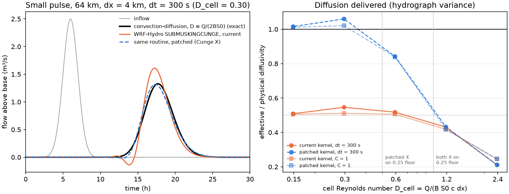
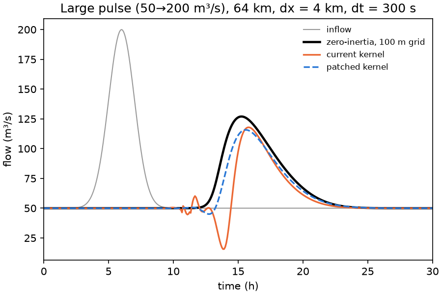

# WRF-Hydro Muskingum-Cunge X: the extra factor of 2

*AI-written (Claude, 2026-10-09; moved here 2026-10-16) at James Halgren's request. Not
yet reviewed by him or anyone else. macOS arm64, gfortran 15.2.0 only.*

Evidence for [NCAR/wrf_hydro_nwm_public#921](https://github.com/NCAR/wrf_hydro_nwm_public/issues/921)
and the draft PR that fixes it.

**Question.** Does the X formula in WRF-Hydro's `SUBMUSKINGCUNGE` deliver the physical
diffusion that Cunge's method is supposed to match, and does the one-token patch in
[`wrf_hydro_mc_x_cunge.patch`](wrf_hydro_mc_x_cunge.patch) fix that?

```bash
repro/wrfhydro_mc_x_factor/run.sh   # ~1 min; exit 0 = reproduced (37 checks)
```

Needs `uv`, `gfortran` and `patch`. Python dependencies are pinned in `pyproject.toml`
and `uv.lock`.

## What it does

1. **`derive_modified_equation.py`** (sympy). It Taylor-expands the Muskingum box
   scheme, the scheme behind the kernel's C1–C3 with K = Δx/c. The scheme adds
   numerical diffusion ν = c·Δx·(½ − X) + c²·Δt·(θ − ½). Muskingum uses θ = ½, so
   ν = c·Δx·(½ − X). Setting ν equal to the physical diffusivity D = Q/(2·B·S0) gives
   X = ½(1 − Q/(B·S0·c·Δx)). The kernel's X gives ν = Q/(4·B·S0) = D/2.
2. **`build_harness.py`** builds two copies of WRF-Hydro's `SUBMUSKINGCUNGE`.
   - It downloads `src/Routing/module_channel_routing.F90` from NCAR/wrf_hydro_nwm_public
     at `55ed71c8` (main, 2026-10-09) and applies the patch.
   - It extracts the subroutine verbatim from the original and from the patched file.
     Stubs (`fortran/stubs.F90`) stand in for `hydro_stop`, `linkls_s` and `my_id`.
   - It compiles both with WRF-Hydro's own gfortran flags, into one driver
     (`fortran/driver.F90`). The driver routes an inflow through N identical reaches,
     taking the upstream inflow from the current step, with no lateral inflow and no
     channel loss.
   - The whole WRF-Hydro model was **not** built: its CMake build needs MPI, which is
     not installed here.
3. **`analyze.py`** runs the experiment on one prismatic trapezoidal channel:
   Q0 = 50 m³/s, Bw = 20 m, ChSlp = 0.5, n = 0.045, S0 = 10⁻³, routed 64 km.
   - The segment length Δx is 0.5–8 km, so the cell Reynolds number
     D_cell = Q/(B·S0·c·Δx) runs from 2.4 down to 0.15.
   - The time step is the NWM's 300 s and also the one that gives C = 1.
   - **Small pulse (5% of base flow, linear regime).** Compared against the exact
     convection–diffusion solution (Hayami kernel). A fine-grid (100 m) zero-inertia
     solver agrees with it to 0.1% at the peak.
     - The headline metric is the effective diffusivity. It comes from the growth of
       the hydrograph's temporal variance: D_eff = Δσ²·c³/(2L).
     - The same linear test is also run with constant-parameter MC, which isolates the
       factor 2.
   - **Large pulse (50 → 200 m³/s, nonlinear).** Compared against the zero-inertia
     solver.
4. **`check.py`** runs 37 checks against `expected/expected.json`.

## Results (`results/table.txt`, `results/summary.json`, figures)

`run.sh` writes everything to `results/` (not committed). The two figures below are
copies from the 2026-10-16 run, kept in `figures/` so they show on GitHub.



**Linear, constant-parameter MC.**
- With the kernel's X, D_eff/D = 0.500 in every case.
- With Cunge's X, D_eff/D = 1.000. Both hold to 3 decimals and at C = 0.06 to 1.

**The verbatim WRF-Hydro routine, small pulse.**

| D_cell | X on the 0.25 floor? | current kernel D_eff/D | patched D_eff/D | peak above base, current / patched (exact = 1) |
|---|---|---|---|---|
| 0.15 | neither | 0.51 | 1.01–1.02 | 1.10–1.34 / 0.96–1.06 |
| 0.30 | neither | 0.51–0.55 | 1.02–1.06 | 1.21–1.25 / 0.99 |
| 0.59 | patched only | 0.51–0.52 | 0.84 | 1.24 / 1.06 |
| 1.19, 2.37 | both | 0.21–0.43 | identical | 1.30–1.51 / identical |

So the current kernel delivers half the physical diffusion wherever its X is not on
the floor, and the patch restores it. Where both X are on the 0.25 floor
(D_cell > 1), the patch changes nothing. There, the floor under-diffuses by its own
amount, and peaks are 30–50% too high above base flow.



**Large pulse (nonlinear), against the zero-inertia reference.**
- The patch lowers the hydrograph RMSE in all 9 cases (by 4% to 71%). It brings the
  volume closer to the inflow volume in 6 of 9 cases.
- It does **not** improve the peak. The absolute peak error gets worse in 7 of 9 cases
  and better in 2. At dx = 8 km, dt = 300 s, the current kernel's peak happens to match
  (error +0.000 of the reference's peak above base flow), against −0.196 patched.
- In this regime the routine's other errors are as large as the X effect or larger:
  - a leading-edge dip that reaches 8–27 m³/s at small Courant numbers;
  - timing errors of +2.4 h at C ≈ 1, where the K clamp binds at high flow;
  - volume losses of 10–70% of the pulse.

  So the nonlinear peak comparison mixes compensating errors. It is reported as
  context, not as evidence for or against the fix.

## Caveats

- One channel geometry, in-bank only. The overbank (`TwCC`) branch is changed
  identically by the patch but was not exercised here.
- Sequential (current-step) upstream inflow, not the NWM's lagged one
  (`assume_short_ts`). No lateral inflow, no channel loss, no reservoirs.
- **The volume losses in the large-pulse runs were not diagnosed.** They grow with
  pulse amplitude (1% at 5% of base flow, 16% at 100%, 70% at 300%, at dx = 8 km and
  dt = 2700 s). That is the signature of variable-parameter MC volume loss (Tang et
  al. 1999), but a harness artifact has not been ruled out. They are not part of this
  claim.
- The patched file was compiled only as the extracted subroutine. The full model was
  not built.
